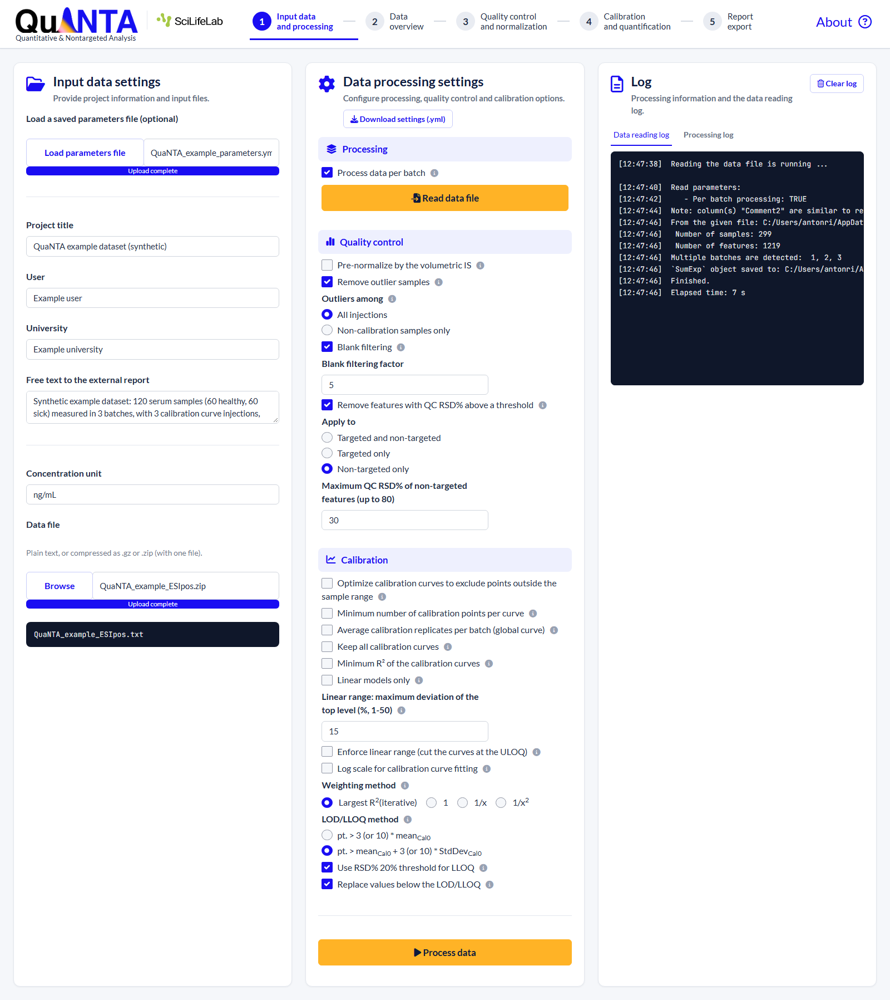
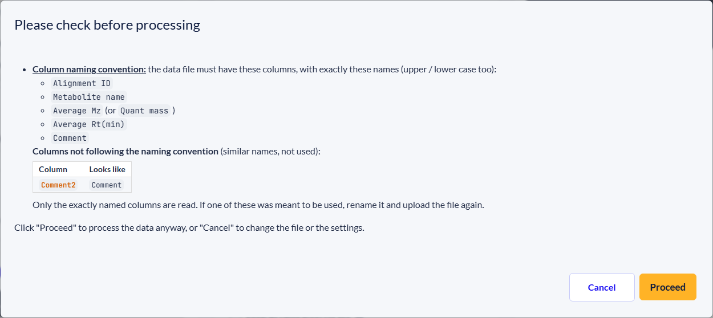
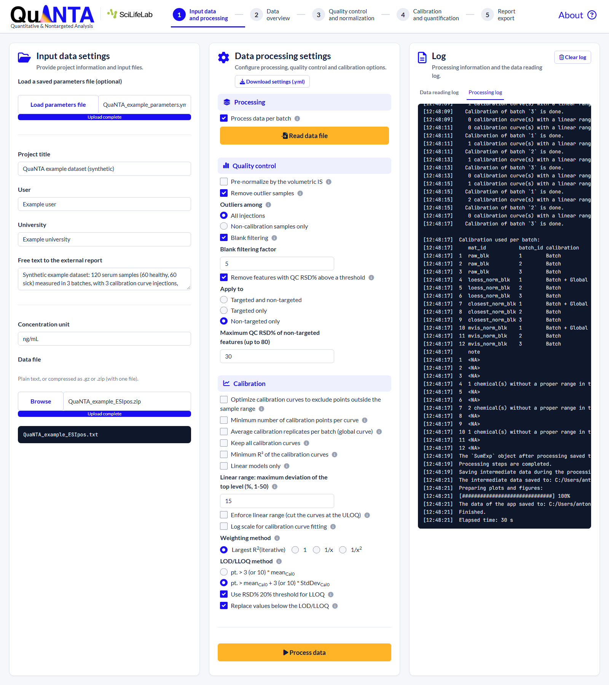

```{r}
#| label: setup
source("_prepare.R")
box::use(util = projlib/msdial_utils, settings = projlib/settings)
raw <- tut$raw
cd <- SumExp::col_df(raw)
```
The start page of QuaNTA where metadata is provided, data is uploaded, read and processed using the settings provided by the user.
All settings and metadata can be saved as a parameters file for ease of reprocessing with new settings or same settings for new data.
<br>

## File structure

QuaNTA reads a `.txt` file formatted according to the [MS-DIAL](https://systemsomicslab.github.io/compms/msdial/main.html) **alignment result** output format.
Upload it as it is, or compressed as `.zip` or `.gz`.

The file has two parts: four rows of **sample information** at the top, and below them one row of headers above all
**feature** (a compound or an unknown peak) rows with its peak area in every sample. This is the top-left
corner of the example file:

```{r}
#| label: table-file-corner
lines <- readLines(tut$input_file, n = 9, warn = FALSE)
cells <- strsplit(lines, "\t", fixed = TRUE)
hdr <- cells[[5]]
keep_info <- match(c("Alignment ID", "Average Rt(min)", "Average Mz", "Metabolite name", "Comment"), hdr)
first_smp <- which(hdr %in% cd$sample_name)[1:4]
# The column before the samples names the four sample rows ("Class", "File type", ...)
cols <- unique(c(keep_info, first_smp[1] - 1, first_smp))
corner <- t(vapply(cells, function(x) { x <- c(x, rep("", max(cols))); gsub('"', "", x[cols]) }, character(length(cols))))
colnames(corner) <- rep("", length(cols))
knitr::kable(corner, align = "l") |>
  kableExtra::kable_styling(full_width = FALSE, position = "left", font_size = 12) |>
  kableExtra::row_spec(1:4, background = "#F4F6FB") |>
  kableExtra::row_spec(5, bold = TRUE) |>
  kableExtra::scroll_box(width = "100%")
```

<br>


### The four sample rows

The four sample rows (shaded above) describe each sample column:

| Row | Content | In QuaNTA |
|---|---|---|
| `Class` | the group of the sample, e.g. `Healthy`, `QC1`, `C0-5` | the groups in figures and statistics |
| `File type` | `Sample`, `QC`, `Standard` or `Blank` | study sample, QC, calibration sample or method blank |
| `Injection order` | a number | the order along the sequence (drift, figures over the sequence) |
| `Batch ID` | a number | blank subtraction and calibration per batch |


### The feature columns

QuaNTA needs these feature columns (exact names): `Alignment ID`, `Average Rt(min)`,
`Average Mz`, `Metabolite name` and `Comment`. Other columns are ignored.


### Naming conventions

The **`Comment`** column tells QuaNTA what each feature is:

| Comment | Meaning |
|---|---|
| `Quant` | a targeted compound, quantified with a calibration curve |
| `Quant\<class>` | a targeted compound with a compound class after the backslash, e.g. `Quant\ATZ` |
| `IS` | an isotope-labelled internal standard |
| `IS\<class>` | an internal standard with a compound class, e.g. `IS\ATZ` |
| `vIS` | the volumetric internal standard (added to check and correct the volume) |
| `R` | removed from the data when it is read |
| empty or anything else | a non-targeted feature |

The **calibration samples** (`File type` = `Standard`) carry their concentration in the sample
name, after `Cal`, with a dash for the decimal point: `Cal0` (the zero calibrant), `Cal0-005` (0.005),
`Cal0-5` (0.5), `Cal10` (10). **QC samples** with the same `Class` are replicates of one QC material;
several QC materials (e.g. `QC-low`, `QC-high`) are possible.

### Example dataset

The example dataset provided with the QuaNTA app is completely synthetic and has `r sum(util$is_targeted_feature(raw))` targeted compounds,
`r sum(util$is_internal_std(raw))` internal standards, `r sum(util$std_type(raw) %in% "vIS")` volumetric internal
standard and `r sum(is.na(util$std_type(raw)) | util$std_type(raw) == "")` non-targeted features, measured in
`r ncol(raw)` samples in `r length(unique(cd$batch_id))` batches.

::: {.callout-warning}
## Check before uploading
When you click **Process data**, QuaNTA lists `Comment` values that do not follow the conventions
(e.g. `quant`, `IS-ATZ`) and column names that look like the required ones but are not exact
(e.g. `Comment2`). Values that look like `Quant` or `IS` are shown in red: they would be treated
as non-targeted. Fix them in MS-DIAL or in the file and upload again.
:::

## Uploading and reading

The initial page has 3 sections: Input and metadata, reading and processing data and logs

{.screenshot}


### Upload file, read and process
1. If the user has previously saved a parameters file it contains metadata, processing settings and which dataset was uploaded at the time of saving it.
2. Otherwise, fill in metadata (optional), choose a `.txt`, `.zip` or `.gz` (containing a `.txt` file) by clicking "Browse" in lower left corner
3. Choose whether to process batch-wise or globally and read file by clicking "Read data file".<br> Section 2 is now viewable.

{.screenshot}

## Processing settings

The settings are grouped as in the app. Hover the ⓘ next to each in the app for the full
explanation; options that the data cannot support (e.g. a volumetric IS option without a vIS) are
greyed out.

```{r}
#| label: table-settings
desc <- c(
  per_batch = "Blank subtraction and calibration per batch (Batch ID); otherwise all batches together.",
  vis_prenorm = "Divide all peak areas by the volumetric IS of each sample before normalization.",
  rm_outlier = "Remove samples in which more than 20% of the internal standards deviate by more than 3 SD (log scale).",
  rm_outlier_scope = "Which samples can be removed as outliers: all injections, or all but the calibration samples.",
  blank_filter = "Remove features whose maximum (or mean) in the study samples is not above factor × the blank mean.",
  blank_filter_factor = "The factor of the blank filter.",
  blank_filter_stat = "Compare the blank mean with the maximum or the mean of the study samples (QCs and calibration standards do not count).",
  rsd_filter = "Remove features with a high RSD% among the QC replicates (after normalization and blank subtraction).",
  rsd_filter_scope = "Targeted, non-targeted features or both.",
  rsd_max_targeted = "Maximum QC RSD% of targeted compounds.",
  rsd_max_nontargeted = "Maximum QC RSD% of non-targeted features.",
  optimize_cal_points = "End each curve just above the highest study sample (keeping the minimum number of levels).",
  set_minimum_number = "Require more calibration levels than 3 per curve ...",
  min_cal_points = "... namely this many.",
  average_cal_reps = "Average the replicates of each calibration level within a batch: per batch, each batch's own curve on its averages; otherwise one global curve with one point per level and batch.",
  keep_all_calcurves = "Keep the curves of compounds without a valid range (marked), instead of leaving them out; and export compounds with a curve also when no study sample is above the LLOQ.",
  r2_filter = "Curves with a lower R² than the minimum are not valid ...",
  min_r2 = "... namely this R².",
  linear_only = "Fit linear curves only (no quadratic ones).",
  linear_range_tol = "ULOQ of linear curves: top levels whose back-calculated mean deviates more than this (%) are above the linear range.",
  enforce_linear_range = "Cut the curves at their ULOQ and refit them (otherwise they keep their range).",
  log_calibration = "Fit the curves in log scale (weighting 1 only); the ULOQ is then found by SCALiR.",
  weight = "Weighting of the fit: the one with the largest R² (and the model), or a fixed 1, 1/x, 1/x².",
  llox_method = "LOD / LLOQ thresholds from the zero calibrant: 3 / 10 × its mean, or its mean + 3 / 10 SD.",
  use_rsd20 = "The LLOQ level must also have an RSD% of at most 20%.",
  impute_llox = "Replace values below the LOD / LLOQ by LLOQ/4 and LLOQ/2 (otherwise reported as n.d. / n.q.)."
)
group <- c(per_batch = "Reading", vis_prenorm = "Quality control", rm_outlier = "Quality control",
           rm_outlier_scope = "Quality control", blank_filter = "Quality control", blank_filter_factor = "Quality control",
           blank_filter_stat = "Quality control", rsd_filter = "Quality control", rsd_filter_scope = "Quality control", rsd_max_targeted = "Quality control",
           rsd_max_nontargeted = "Quality control")
po <- settings$processing_options
show_val <- function(v) if (is.logical(v)) ifelse(v, "Yes", "No") else as.character(v)
tbl <- tibble::tibble(
  Group = ifelse(po$id %in% names(group), group[po$id], "Calibration"),
  Setting = po$id,
  Default = vapply(po$default, \(x) show_val(x[[1]]), ""),
  `What it does` = unname(desc[po$id])
) |>
  dplyr::filter(!is.na(`What it does`)) |>
  dplyr::arrange(factor(Group, c("Reading", "Quality control", "Calibration")))
tut_table(tbl, height = "480px")
```

<br>

### Processing data

4. Having chosen your processing settings click **Process data**. A popup will warn you of any problems detected in the raw data.

{.screenshot width="75%"}

5. Click **Proceed** to start. The *Processing log* on the right shows the progress; when it ends
with "Finished.", pages 3 and 4 show the results.

{.screenshot}

::: {.callout-tip}
## Save your settings
**Download settings (.yml)** saves metadata, processing settings and the name of the
dataset.
:::
